<h1 align="center">Muthu Kumaaran C</h1>

Building clean, reliable systems. 
 
<picture></picture>

  <strong>Connect</strong> 
  &nbsp;&nbsp;
  &nbsp;&nbsp;
   
  

<h3 align="center">Tech Stack</h3>

<table align="center">
  <tr>
    <th colspan="2" align="center">MERN Stack</th>
    <th colspan="2" align="center">Languages</th>
  </tr>
  <tr>
    <td align="center" valign="top" width="144"> MongoDB</td>
    <td align="center" valign="top" width="144"><picture><source media="(prefers-color-scheme: dark)" srcset="assets/icons/express-dark.svg"></picture> Express&#8203;.js</td>
    <td align="center" valign="top" rowspan="2" width="144"> Python</td>
    <td align="center" valign="top" rowspan="2" width="144"> Java&#8203;Script</td>
  </tr>
  <tr>
    <td align="center" valign="top"> React</td>
    <td align="center" valign="top"> Node.js</td>
  </tr>
  <tr>
    <th colspan="2" align="center">Backend</th>
    <th colspan="2" align="center">Databases &amp; Caching</th>
  </tr>
  <tr>
    <td align="center" valign="top" width="144"> FastAPI</td>
    <td align="center" valign="top" width="144"> Celery</td>
    <td align="center" valign="top" width="144"> MySQL</td>
    <td align="center" valign="top" width="144"> Redis</td>
  </tr>
  <tr>
    <th colspan="2" align="center">Infrastructure</th>
    <th colspan="2" align="center">Version Control</th>
  </tr>
  <tr>
    <td align="center" valign="top" width="144"><picture><source media="(prefers-color-scheme: dark)" srcset="assets/icons/aws-dark.svg"></picture> AWS</td>
    <td align="center" valign="top" width="144"> Docker</td>
    <td align="center" valign="top" rowspan="2" colspan="2"> Git</td>
  </tr>
  <tr>
    <td align="center" valign="top" colspan="2"> Linux</td>
  </tr>
</table>

