<h1 align="center">Muthu Kumaaran C</h1>

Building clean, reliable systems. 

  <strong>Connect</strong> 
  &nbsp;&nbsp;
  &nbsp;&nbsp;
  

<strong>Tech Stack</strong>

<table align="center" width="100%">
  <tr>
    <td align="center" width="50%">
      <strong>MERN Stack</strong> · Learning 
      <picture><source media="(prefers-color-scheme: dark)" srcset="assets/icons/express-dark.svg"></picture>
    </td>
    <td align="center" width="50%">
      <strong>Languages</strong> 
      &nbsp;
    </td>
  </tr>
  <tr>
    <td align="center">
      <strong>Backend</strong> 
      &nbsp;
    </td>
    <td align="center">
      <strong>Databases &amp; Caching</strong> 
      &nbsp;
    </td>
  </tr>
  <tr>
    <td align="center">
      <strong>Infrastructure</strong> 
      <picture><source media="(prefers-color-scheme: dark)" srcset="assets/icons/aws-dark.svg"></picture>&nbsp;&nbsp;
    </td>
    <td align="center">
      <strong>Version Control</strong> 
      
    </td>
  </tr>
</table>

